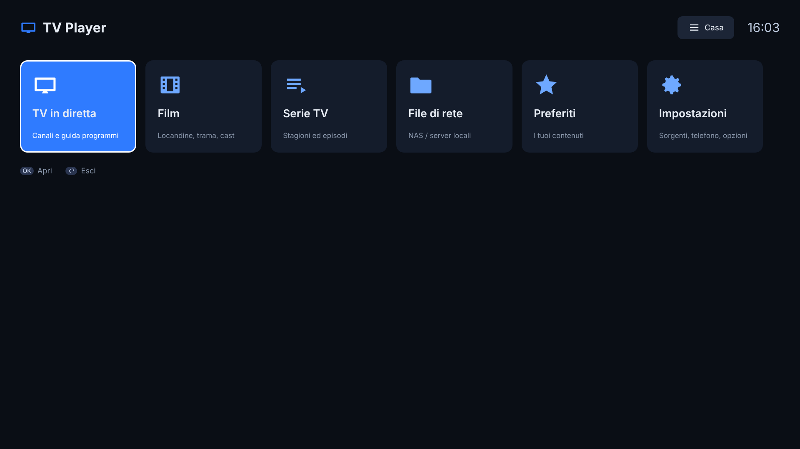

# MAXENTA — Android TV · Google TV · Fire OS · Tizen · webOS · VIDAA · Windows · macOS · Linux

Player multimediale per televisori: **TV in diretta, film e serie** da playlist **M3U/M3U8**, da **Xtream Codes API** e da **server di rete (NAS)**, pensato per il **solo telecomando**, con interfaccia leggera.

Una sola codebase web (HTML/CSS/JS, nessun framework, ~105 KB). Tizen, webOS e VIDAA sono nativamente piattaforme web; per Android TV/Google TV la stessa app viene impacchettata in una WebView (Capacitor).



## Cosa fa

| Area | Funzioni |
|---|---|
| **TV live** | Categorie · canali (loghi, numero) · **"ora in onda" con barra di avanzamento** · pannello anteprima con descrizione e prossimi 4 programmi · anteprima video opzionale · zapping ▲▼ e **numerico** · preferiti · ricerca |
| **Guida (EPG)** | XMLTV (anche `.gz`) da `url-tvg` o URL manuale; per Xtream anche EPG breve per il solo canale selezionato (leggerissimo) |
| **Film / Serie** | Griglia di locandine · scheda laterale con **trama, anno, voto, genere, cast** · scheda dettaglio · stagioni/episodi · **"Riprendi da mm:ss"** · episodio successivo automatico |
| **Xtream API** | Live, VOD, serie, info, EPG, verifica account (stato/scadenza/connessioni) |
| **M3U** | URL o file (inviato dal telefono / scelto dal NAS); riconosce da solo live, film e serie (`S01E02`) |
| **NAS** | **WebDAV** (Synology, QNAP, TrueNAS, Nextcloud…) e **indice HTTP** (nginx/apache/miniserve). Sfoglia cartelle, mostra **locandina e trama dai file Kodi** (`.nfo`, `-poster.jpg`), riproduce, importa `.m3u` come sorgente |
| **Player** | HLS nativo se la TV lo ha, altrimenti **hls.js**; MPEG-TS con **mpegts.js**; MP4/MKV nativi. Catena di fallback automatica (HLS ⇄ TS), audio/sottotitoli, riempi/adatta schermo, ripresa |
| **Input** | Telecomando · tastiera fisica Bluetooth/USB · tastiera a schermo · tastiera di sistema della TV · **smartphone come tastiera e telecomando** |

## Provarlo subito su PC (2 minuti)

```bash
npm install                 # solo per rigenerare/collaudare; l'app in www/ è già compilata
node companion/server.js    # relay telefono + proxy CORS + ospita l'app
# apri http://localhost:8787/app/   (frecce, Invio, Esc = telecomando)
```
Sulla home premi **“Prova con la sorgente demo”** (flussi pubblici di prova), oppure **Aggiungi sorgente**.

## Versione per computer (Windows · macOS · Linux)

Lo stesso codice gira in una finestra **Electron** con adattamenti per mouse e tastiera. Pensata per **non dover digitare nulla**:

| Cosa vuoi fare | Come |
|---|---|
| Aggiungere una playlist o un account Xtream | Copia il link (anche l'URL `get.php?username=…&password=…` del provider) e premi **Ctrl+V** (⌘V su Mac) in qualunque schermata: riconosce da solo M3U, Xtream (estrae server/utente/password), WebDAV, flusso singolo, oppure il testo di una playlist `#EXTM3U` |
| Aggiungere un file `.m3u` | Trascinalo nella finestra, oppure **Ctrl+O**, oppure doppio clic sul file (l'app si registra come lettore `.m3u/.m3u8`) |
| Trovare il NAS | **Cerca NAS in rete**: SSDP/DLNA e mDNS (WebDAV, Synology/QNAP…) senza scrivere indirizzi |
| Usare file del computer o un NAS già montato (SMB/NFS) | **Cartella del computer…**: sfogli film con locandine e trame `.nfo` |
| Guardare | Clic = apri · tasto destro = opzioni · rotella = scorri · doppio clic nel player = schermo intero · barra di avanzamento cliccabile · Spazio, F, M, ←→, +/− |

Se il provider blocca i browser, in **Impostazioni › Identità del lettore** puoi presentarti come VLC, Kodi o okhttp. Il codice DLNA/mDNS gira nel processo principale: niente proxy né CORS.

### Installazione (formato nativo per ogni sistema)

| Sistema | File | Note |
|---|---|---|
| **Windows 10/11** | `MAXENTA-x.y.z-win-x64.exe` (installer NSIS, per-utente, **senza permessi di amministratore**) e versione `portable` | Non firmato: SmartScreen mostra “Windows ha protetto il PC” → *Ulteriori informazioni › Esegui comunque* |
| **macOS 11+** | `MAXENTA-x.y.z-mac-universal.dmg` (Intel + Apple Silicon): trascina nelle Applicazioni | Non firmato/notarizzato: la prima volta tasto destro › Apri, oppure `xattr -dr com.apple.quarantine "/Applications/MAXENTA.app"` |
| **Linux** | `.AppImage` (qualunque distro: `chmod +x` e doppio clic) · `.deb` (Debian/Ubuntu/Mint: `sudo apt install ./MAXENTA-*.deb`) · `.rpm` (Fedora/openSUSE, solo da CI) | Il `.deb` aggiunge icona al menu e associazione `.m3u` |

**Come ottenerli.** I pacchetti Windows e macOS si costruiscono solo sul rispettivo sistema: il file `.github/workflows/build.yml` li produce tutti su GitHub Actions (carica il progetto su un repository GitHub, poi *Actions › Build › Run workflow* oppure crea un tag `v1.1.0`: gli installer compaiono negli artefatti e nella Release). In locale: `npm install && npm run build`, poi `npm run desktop` (prova), `npm run dist:linux` / `dist:win` (su Windows) / `dist:mac` (su Mac).

Prossimi passi consigliati per la distribuzione pubblica: certificato di firma Windows (evita SmartScreen) e Apple Developer ID + notarizzazione (necessario per gli aggiornamenti automatici su macOS).

### Film e serie (VOD) che non partono o non scorrono — convertitore integrato

Il player usa il motore video di Chromium, che non legge alcuni formati (HEVC/H.265 su molti sistemi, audio AC3/E-AC3/DTS, certi MKV) e non permette di **scorrere la timeline** se il server non supporta le richieste a intervalli (*Range*), come capita con molti provider IPTV. Nell'app per computer c'è quindi un convertitore **ffmpeg** incluso:

- **Automatico** (predefinito): se il file non parte, parte muto, o la timeline non scorre, passa da solo al convertitore e riprende dallo stesso punto. Il video H.264 viene solo "ripacchettato" (poca CPU); il resto è ricodificato in H.264/AAC (usa più CPU).
- Lo scorrimento funziona anche così: la barra riparte dal punto scelto. Si può cambiare traccia audio; i sottotitoli incorporati non sono ancora supportati in questa modalità.
- Se qualcosa non va: nel player apri **Opzioni › “Non va / non scorre? Usa il convertitore video”**, oppure in **Impostazioni › Convertitore video** scegli *Sempre* o *Mai*.
- Se il file non parte nemmeno così, il messaggio d'errore ora riporta i dettagli tecnici (es. `errore SRC_NOT_SUPPORTED → convertitore: HTTP error 403`) utili per capire se è un blocco del provider.

Nota licenze: ffmpeg-static include un binario ffmpeg con licenza GPL (libx264). Per uso personale non cambia nulla; se distribuisci l'app ad altri, rispetta la GPL (indicare l'uso di ffmpeg e rendere disponibili i sorgenti) o sostituiscilo con una build LGPL.
**Sulle TV** (Tizen, webOS, Android TV…) il convertitore non esiste: lì conta ciò che il decoder della TV sa fare.

### Aggiornamenti automatici (app per computer)

L'app controlla da sola gli aggiornamenti 6 secondi dopo l'avvio (e da **Impostazioni › Aggiornamenti dell'app** o dal menu *Aiuto › Controlla aggiornamenti*). Se c'è una versione nuova chiede se scaricarla, la scarica in background e propone **Riavvia ora**; configurazione, sorgenti e preferiti restano. Le versioni arrivano dalle **GitHub Releases** del tuo repository.

**Una tantum:** crea un repository GitHub (pubblico) e carica il progetto. Non devi modificare nulla: il workflow imposta da solo repository e versione.

**A ogni modifica:** `npm run build` non serve, fa tutto la CI. Basta

```
git add -A && git commit -m "descrizione" && git tag v1.3.0 && git push && git push --tags
```

GitHub Actions compila Windows, macOS e Linux e pubblica la Release con i file `latest*.yml` che le app installate leggono. (La versione è quella del tag.)

| Sistema | Aggiornamento dall'app aperta |
|---|---|
| Windows (installer `.exe`) | Sì, automatico. La versione *portable* non si aggiorna da sola |
| Linux **AppImage** | Sì, automatico (sostituisce il file) |
| Linux `.deb` / `.rpm` | No: l'app avvisa e apre la pagina di download |
| macOS | Richiede un'app **firmata** (Apple Developer ID, 99 $/anno): senza firma l'aggiornamento automatico fallisce e l'app ti manda alla pagina di download per installare a mano |

Per provarlo in locale senza GitHub: `UPDATE_FEED_URL=http://localhost:9300/ ./TV-Player.AppImage` con una cartella servita contenente `latest-linux.yml` e il nuovo AppImage.

## Amazon Fire TV (Fire OS)

I Fire TV con **Fire OS** sono Android: si usa lo **stesso APK** di Android TV (`packaging/android/setup.sh`, poi `assembleDebug`). L'app viene riconosciuta come `firetv` (tasti: D-pad, Indietro, Menu e tasti multimediali del telecomando Alexa funzionano come su Android TV).

Installazione tramite sideload: *Impostazioni › Il mio Fire TV › Opzioni sviluppatore* → **Debug ADB** e **Installa app sconosciute** su ON; poi `adb connect <IP>:5555 && adb install -r app-debug.apk`, oppure scarica l'APK con l'app **Downloader**.

Limiti da sapere: (1) i modelli con **Vega OS** (Fire TV Stick 4K Select, Stick HD 2026 e futuri) **non eseguono APK** e non permettono sideload: servirebbe una versione Vega ufficiale tramite Amazon Appstore (non fattibile con questo progetto così com'è); (2) Amazon ha iniziato a bloccare alcuni APK sideloaded anche su Fire OS e, secondo segnalazioni, certi aggiornamenti di TV Fire OS 8 hanno tolto il sideload; (3) i Fire TV più vecchi (Fire OS 5, Android 5.1) hanno WebView obsoleta e Capacitor recente richiede Android 6+/7+, quindi supporta Fire OS 6 in su; (4) il codice è lo stesso dell'APK Android TV, che qui **non ho potuto compilare né provare** (manca l'Android SDK nel sandbox).

## Finestrella, lingua audio, "Continua a guardare"

- **Finestrella (tutte le piattaforme):** nel player, *Indietro* riduce il video a un riquadro in un angolo e riporta alla schermata precedente: puoi navigare tra categorie, film e serie mentre il flusso continua (audio compreso). Per tornare a tutto schermo: **tasto Blu** (TV) o **clic** (desktop). **Stop** (o la X) chiude il player. Scegliendo un altro contenuto, la finestrella si chiude da sola. Disattivabile in Impostazioni ("Indietro dal player = finestrella").
- **Lingua audio:** tasto **Blu** nel player (o menu *Audio e sottotitoli*). Le lingue hanno nomi leggibili (Italiano, English…) con codec e canali. La scelta viene **ricordata** e applicata ai contenuti successivi che offrono quella lingua. Funziona con HLS multi-audio su tutte le piattaforme; sul desktop anche con MP4/MKV multi-traccia (le tracce le legge ffmpeg e il cambio passa dal convertitore). Sulle TV i file MP4/MKV/TS multi-audio dipendono dal lettore nativo del sistema: se il sistema non espone le tracce, l'app non può elencarle.
- **Continua a guardare:** solo film, episodi e file (mai canali live). *Rimuovi riga* (tasto **Giallo** / **Canc** / pulsante) la toglie dalla Home; recenti, "ultimo canale" e progressi di film e serie restano salvati.
- **Sfondi:** 8 wallpaper astratti (SVG → JPG 1080p e 4K, in `www/wallpapers/`, rigenerabili con `scripts/gen-wallpapers.py`), inclusi nell'installer per tutte le piattaforme. Generati per il progetto, nessuna licenza di terzi.

## Telecomando

| Tasto | Azione |
|---|---|
| ◀▲▼▶ / OK / Indietro | navigazione, selezione, indietro |
| **OK lungo** (>0,6 s) | menu opzioni dell'elemento (Android TV non ha tasti colorati) |
| 🔴 Rosso | preferito · 🟢 Verde | cerca · 🟡 Giallo | cambia sorgente · 🔵 Blu | audio/sottotitoli |
| CH± / ▲▼ (in player live) | canale successivo/precedente · **0‑9**: numero canale |
| ◀▶ / ⏪⏩ (film) | ±10 s / ±30 s (pressioni ripetute accelerano) · ⏯ ⏹ ℹ |

Sul PC: frecce, Invio, Esc/Backspace, F1‑F4 = colori, PagSu/PagGiù = CH±.

## Tastiera: tutte le strade (richiesta chiave)

1. **Tastiera a schermo** integrata, navigabile col D‑pad (minuscole/maiuscole, simboli, scorciatoie `http://`, `https://`, `www.`, `.com`, `:8080`). Funziona identica su tutte le TV.
2. **Tastiera fisica** Bluetooth/USB: si scrive direttamente nel campo, **Invio conferma**.
3. **Tastiera di sistema della TV** (pulsante *“Tastiera di sistema”*): l'app mette il focus su un vero `<input>`. È l'unico “API” necessario: su Tizen, webOS, VIDAA e Android (WebView) il focus su un campo di testo fa comparire la tastiera nativa, e quindi funzionano anche le app remote dei produttori che scrivono con la tastiera del telefono (Google TV remote, Samsung SmartThings, LG ThinQ, Hisense RemoteNOW). Su Android si può anche forzare con `@capacitor/keyboard` → `Keyboard.show()` (già incluso da `setup.sh`).
4. **Smartphone come tastiera/telecomando** con il *companion* (sotto): QR code → pagina web sul telefono → ciò che scrivi compare **in tempo reale** nel campo aperto sulla TV; in più frecce/OK/CH±, invio di **playlist M3U**, **sorgenti Xtream/NAS** e **URL da riprodurre subito**.

> Le web app TV non possono aprire un server HTTP in ascolto: per questo il telefono parla col companion e la TV si collega a lui. Se non vuoi il companion, restano i punti 1‑3.

## Companion (facoltativo ma consigliato)

Programma Node senza dipendenze da avviare su NAS / Raspberry Pi / PC (stessa LAN della TV):

```bash
node companion/server.js                    # porta 8787
docker compose up -d --build                # oppure con Docker
```
Fa tre cose: **relay** telefono⇄TV · **proxy CORS** (`/proxy?url=…`: aggiunge CORS, inoltra Range/PROPFIND/Basic‑auth, decomprime `.gz`, riscrive i manifest HLS) · **hosting** dell'app su `/app/` (utile per VIDAA e per i browser TV). Accetta solo client della rete locale (`ALLOW_PUBLIC=1` per cambiarlo; `TOKEN=…` per proteggere il proxy).
Nell'app: *Impostazioni → Server companion* (o *Telefono come tastiera*), poi inquadra il QR.

**Quando serve il proxy?** Tizen e webOS (app impacchettate) e Android con `CapacitorHttp` di solito non hanno blocchi CORS. Servono invece per VIDAA/browser TV o se un server blocca CORS: l'app **riprova da sola tramite il companion** quando una richiesta fallisce. Per i video usa *“Video tramite proxy”* solo se necessario.

## Installazione sulle piattaforme

`./scripts/dist.sh` prepara `dist/tizen`, `dist/webos`, `dist/vidaa`, `dist/web`.

**Samsung Tizen** — TV in *Developer mode* (App → `12345` → Developer mode ON + IP del PC). Con Tizen Studio/CLI: `tizen package -t wgt -s <profilo> -- dist/tizen`, poi `tizen install -n TvPlayer.wgt -t <TV>`. Il `config.xml` include i privilegi `internet` e `tv.inputdevice` (tasti colorati/multimediali, registrati in `platform.js`) e `<access origin="*">`. Compatibile da Tizen 4.0 (2018).

**LG webOS** — App *Developer Mode* sulla TV, poi: `ares-setup-device`, `ares-package dist/webos`, `ares-install com.example.tvplayer_1.0.0_all.ipk -d <TV>`, `ares-launch -d <TV> com.example.tvplayer`. Back = tasto 461. Compatibile da webOS 4.0 (2018).

**Hisense VIDAA** — non esiste un sideload libero come su Samsung/LG. Due strade: (a) aprire nel browser della TV `http://IP-companion:8787/app/` (preferiti del browser); (b) pubblicare `dist/vidaa` tramite il portale sviluppatori VIDAA per l'app store. I codici tasto VIDAA (Back/colori) sono gestiti con gli standard `Escape`/`ColorF*Red`… ma **vanno verificati su un televisore reale** (vedi “Cosa è verificato”).

**Android TV / Google TV** — `packaging/android/setup.sh` crea il progetto Capacitor, imposta `LEANBACK_LAUNCHER` (icona nel launcher TV), niente touchscreen obbligatorio, HTTP in chiaro, `CapacitorHttp` (niente CORS) e il tasto indietro. Poi `./gradlew assembleDebug` e `adb install`. Richiede Android Studio/SDK.

## Perché è leggero

- Liste e griglie **virtualizzate**: ~16 nodi DOM anche con 50.000 canali (provato con 3.000: scorrimento rapido in ~0,4 s).
- Solo `transform`/`opacity`, niente ombre/blur/animazioni (modalità *Risparmio risorse* attiva di default); loghi caricati solo se visibili.
- hls.js e mpegts.js si caricano **solo quando servono**; un solo `<video>`, distrutto a ogni cambio canale; buffer configurabile (10/20/40 s).
- Cataloghi in **IndexedDB** (avvio immediato, aggiornamento in background); EPG filtrato per i soli canali presenti e finestra di 6‑48 h; Xtream VOD/serie caricati **per categoria**.
- Bundle compilato per **Chromium 53+** (webOS 4, Tizen 4): niente CSS grid/gap/clamp.

## Struttura

```
src/core      tasti, navigazione spaziale, storage, rete, parser M3U/XMLTV, EPG, router, relay
src/sources   m3u.js · xtream.js · dav.js (WebDAV/HTTP)
src/ui        lista virtualizzata, tastiera, modali, motore di riproduzione (nativo/hls.js/mpegts.js)
src/screens   home · live · vod · detail · files · favs · settings · player
companion/    server.js (relay+proxy+hosting) · remote.html (pagina del telefono) · Dockerfile
packaging/    tizen · webos · vidaa · android
test/         mock.js (server finto M3U/Xtream/XMLTV/WebDAV/HLS) · e2e.js · e2e2.js
```
Modifica `src/`, poi `./build.sh` → `www/app.js`.

## Cosa è verificato (e cosa no)

**Verificato** in Chrome 153 headless a 1920×1080, guidando l'app **solo con tasti** e col relay del telefono, contro un server finto senza CORS (`npm test`, 44 controlli): aggiunta sorgente con tastiera fisica e a schermo · prova connessione · M3U + XMLTV · Xtream (3.000 canali, EPG breve, VOD, serie) · riproduzione HLS (nativo e hls.js con proxy), MPEG‑TS (mpegts.js) e MP4 con seek · zapping numerico · OK lungo · preferiti · ripresa film · NAS WebDAV con `.nfo` · scrittura dal telefono · QR. Durante i test è emerso e corretto un bug del proxy video.

**Versione desktop verificata** con Electron 45 reale (display virtuale Linux, pilotato via DevTools; `npm run test:desktop`, 22 controlli): riconoscimento di URL `get.php`/M3U/testo incollato, cartella locale con `.nfo`, clic e rotella, riproduzione `file://`, controlli del player col mouse, lettura DLNA (Browse SOAP/DIDL contro un server finto), blocco della lettura di file non consentiti, impostazioni specifiche del desktop. Gli installer **Linux (AppImage e deb) sono stati generati e l'app impacchettata è stata avviata**. **Non verificati**: installer **Windows e macOS** (non costruibili da Linux: affidati al workflow CI), firma/notarizzazione, la scoperta SSDP/mDNS su una rete con dispositivi veri (nel sandbox non ce ne sono: verificato solo che termini senza errori) e il DLNA contro un server reale (minidlna, Plex, Synology…).

**Non verificato** (nessun televisore/emulatore disponibile): installazione e tasti su **Tizen, webOS, VIDAA, Android TV reali**; i file `config.xml`/`appinfo.json` sono validi come XML/JSON ma non sono stati pacchettizzati con i tool ufficiali; `setup.sh` non è stato eseguito. Aspettati qualche ritocco al primo test su ciascuna TV (codici tasto, CORS, codec).

## Limiti noti / prossimi passi

- **Codec**: il video usa l'HTML5 `<video>` della TV. HEVC, AC3/E‑AC3, MKV dipendono dal modello. Per massima compatibilità si può aggiungere **AVPlay (Tizen)** / **ExoPlayer (Android)** dietro la stessa interfaccia `Engine`.
- **DLNA/UPnP e SMB** non sono accessibili da una web app pura (servono socket UDP/TCP): sulle **TV** usa WebDAV/HTTP (o un plugin nativo su Android); sul **computer** DLNA/UPnP è supportato dall'app Electron e SMB si usa montando la condivisione dal sistema operativo.
- Niente DRM, catch‑up/timeshift, registrazioni, profili multipli; interfaccia solo in italiano.
- Nota: l'app non contiene né fornisce contenuti; usa solo playlist/servizi che hai il diritto di usare.

## Sport, accesso rapido alla TV e connessioni multiple

- **Sport**: nuova tessera in Home. Riconosce da nome di gruppo/canale/categoria (calcio, Serie A, Champions, F1, NBA, DAZN, Sky Sport, Eurosport, tennis, UFC…) le dirette e gli eventi on demand di playlist M3U e account Xtream, e li mostra in un menu con "Dirette sportive", "Eventi on demand" e "Programmi e serie sportive".
- **TV in diretta**: pulsante rapido in alto nella Home e tasto verde / Guida / CH+ / CH- del telecomando.
- **Limite connessioni**: con Xtream l'app legge `max_connections`/`active_cons` e avvisa quando sono tutte in uso; gli errori HTTP 401/403/429/458/509/884 hanno ora un messaggio comprensibile. Se la stessa playlist è attiva su un altro dispositivo e il provider consente una sola connessione, il flusso viene rifiutato dal provider (non dall'app).

## MAXENTA 2.0

**Aspetto** (Impostazioni › Aspetto › Disposizione)
- **A (predefinito)**: barra laterale a sole icone; si allarga con i nomi quando ci entri (Sinistra dal primo elemento di qualsiasi schermata, Destra o Indietro per uscire). Mostra la sezione corrente e, se c'è un video in finestrella, la voce "In riproduzione".
- **B**: pulsanti in alto a sola icona; quello selezionato mostra il nome.
- Orologio al centro (12/24 ore, fuso della TV), versione in basso a destra, scelta della schermata all'avvio (Home, TV, Film, Serie, Sport, Preferiti, ultimo canale).
- Home: "Riprendi", "Continua a guardare" (locandine verticali) e "Canali visti di recente"; OK lungo su una locandina per toglierla dalla riga.

**Player pensato per telecomandi senza numeri né tasti colorati** (es. Samsung SolarCell)

| Tasto | Diretta | Film / episodi |
|---|---|---|
| Su / Giù | cambia canale | — |
| Sinistra | pannello Canali | pannello Episodi · con le informazioni visibili: −10 s (tenuto premuto accelera) |
| Destra | pannello Opzioni (audio, sottotitoli, preferiti, formato, flusso alternativo, finestrella…) | pannello Opzioni · con le informazioni visibili: +10 s |
| OK | informazioni, poi pausa / riprendi | informazioni, poi pausa / riprendi |
| OK lungo | pannello Opzioni | pannello Opzioni |
| Indietro | finestrella | finestrella |
| ▶‖ | — | — |

La finestrella si riporta a schermo intero con ▶‖, dalla voce "In riproduzione" della barra o selezionandola col cursore (Giù dal fondo della pagina). Riaprire lo stesso film, episodio o canale la riespande senza ricaricare. L'OK lungo ora funziona anche sui telecomandi che non ripetono il tasto (timer invece dei keydown ripetuti). La tastiera a schermo ha Shift (una maiuscola) e blocco maiuscole (Shift due volte).

**Leggerezza**
- Guida programmi caricata solo a canale aperto (niente download/parse dell'XMLTV scorrendo la lista).
- Righe delle liste e sfondo non sono più livelli grafici separati: nella lista canali si passa da ~30 livelli (7 megapixel da comporre) a 2.
- Libreria QR caricata solo quando serve; immagini decodificate in modo asincrono; meno scritture di stile a ogni tasto nelle liste.

Icone: [Solar](https://github.com/480-Design/Solar-Icon-Set) di 480 Design (CC BY 4.0). Font: Plus Jakarta Sans (SIL OFL).

## 2.1
- **On Demand**: Film, Serie TV e Sport (on demand) sono schede della stessa schermata; le dirette sportive sono in TV in diretta › categoria Sport.
- **Finestrella** configurabile: sempre, solo canali TV, solo film e serie, mai.
- **Indietro tenuto premuto** chiude il player o la finestrella (telecomandi senza tasto Stop).
- Barra laterale: "In riproduzione" mostra solo il titolo, che scorre se è lungo.
- Home: "Rimuovi riga" anche per i canali visti di recente.
- Suoni di navigazione (sintetizzati, nessun file) disattivabili in Aspetto; muti dentro il player.
- Transizioni più morbide (schermate, pulsanti, pannelli del player, finestrella, avvisi); restano spente con "Risparmio risorse".

## Aggiornamento automatico sulle TV (dalla 2.2)
I pacchetti per **Tizen, webOS, VIDAA e Android TV** sono un "guscio": a ogni avvio leggono
`https://raw.githubusercontent.com/<repo>/updates/version.json` e, se c'è una versione più nuova, scaricano
`app.js` e `app.css` (circa 200 KB), li salvano sulla TV e li avviano. Senza rete si usa l'ultima copia salvata
(o quella inclusa nel pacchetto); se una versione scaricata non parte entro 9 secondi viene scartata.
Il ramo `updates` viene pubblicato dalla CI a ogni release. Reinstallare il pacchetto serve solo quando cambiano
il guscio, i permessi, l'icona o i file statici (font, sfondi, librerie): in quel caso `minShell` in `version.json`
aumenta e le TV con il guscio vecchio restano sulla versione inclusa finché non lo reinstalli.
Prova: `node test/shell-test.js`.
