# MAXENTA

**Player IPTV e multimediale per TV e computer**: TV in diretta, film e serie da playlist **M3U/M3U8**, account **Xtream Codes** e **NAS** di casa, pensato per essere usato **solo col telecomando**.

Gira su **Android TV · Google TV · Fire OS · Samsung Tizen · LG webOS · Hisense VIDAA · Windows · macOS · Linux**, con un'unica base di codice web (JavaScript senza framework, ~185 KB) e si **aggiorna da solo** su tutte le piattaforme.

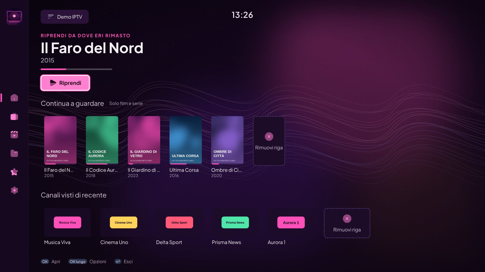

> MAXENTA non contiene né fornisce contenuti: riproduce solo le playlist e i servizi che hai il diritto di usare. Le immagini qui sotto usano un account dimostrativo con canali, film e locandine di fantasia.

---

## Indice
- [Cosa fa](#cosa-fa)
- [Schermate](#schermate)
- [Piattaforme e installazione](#piattaforme-e-installazione)
- [Aggiornamenti automatici](#aggiornamenti-automatici)
- [Comandi](#comandi)
- [Impostazioni principali](#impostazioni-principali)
- [Telefono come tastiera e telecomando (companion)](#telefono-come-tastiera-e-telecomando-companion)
- [App per computer](#app-per-computer)
- [Sviluppo](#sviluppo)
- [Cosa è verificato](#cosa-è-verificato)
- [Limiti noti](#limiti-noti)
- [Crediti e licenze](#crediti-e-licenze)

---

## Cosa fa

| Area | Funzioni |
|---|---|
| **TV in diretta** | Si apre **direttamente sull'elenco dei canali**; le categorie (anche **Sport** automatica) si aprono sopra l'elenco con **Sinistra** o con il pulsante *Categorie*. Loghi e numeri, preferiti, ricerca, zapping con ▲▼ e con i numeri. **Guida TV a griglia** (canali × orari, OK sul programma in onda apre il canale) |
| **On Demand** | Film e serie **insieme** (filtro *Tutto*) o separati (*Film*, *Serie TV*, *Sport*). **Raccolte**: Tutti, Preferiti, **La mia lista** (da guardare più tardi, separata dai preferiti), Continua a guardare. **Ordina** per titolo (A-Z, Z-A) o per valutazione, in tutte le categorie. Etichette colorate **FILM** / **SERIE TV** quando sono mescolati. Locandine, scheda con trama, voto, cast e durata; stagioni ed episodi; ripresa dal punto in cui eri |
| **Home** | Barra **In riproduzione** quando c'è un video nella finestrella (OK = schermo intero), riga **La mia lista** della sorgente scelta in alto, che unisce la lista dell'app e quella salvata sul **portale del provider** (categoria "La mia lista" / "My list") senza doppioni (in Aspetto A al posto dei pulsanti, in Aspetto B sotto), **Canali preferiti** (OK apre il canale e nel player ▲▼ scorre solo tra i preferiti), *Riprendi da dove eri rimasto*, **Continua a guardare** (locandine verticali), **Canali visti di recente**, **File di rete** (una tessera per ogni NAS, cartella o chiavetta USB collegata). Ogni riga si toglie con l'ultima tessera *Rimuovi riga* |
| **Player** | Pensato per telecomandi **senza numeri né tasti colorati**: pannelli laterali per canali/episodi e per le opzioni (audio, sottotitoli, preferiti, formato, flusso alternativo). Lingua audio ricordata. **Episodio successivo automatico** con conto alla rovescia (Indietro lo annulla, *Disattiva* lo spegne). **Finestrella** per continuare a guardare mentre navighi |
| **Ricerca unica** | Una sola ricerca su canali, film e serie della sorgente scelta, risultati in tre gruppi (voce *Cerca* nella barra laterale) |
| **Chiavette USB** | Computer: le chiavette e i dischi esterni compaiono da soli. Android/Google TV: compaiono da soli; la prima volta Android chiede il permesso di leggerle. Samsung: tramite le API di Tizen (da verificare sul televisore). LG e Hisense non permettono alle app di leggere la USB |
| **Sorgenti** | M3U/M3U8 (URL o file), Xtream Codes (live, film, serie, guida, stato account e connessioni), **NAS**: WebDAV, indice HTTP, cartelle del computer, condivisioni Windows/SMB (app per computer), DLNA (app per computer). Legge locandine e trame dei file Kodi (`.nfo`, `-poster.jpg`) |
| **Lettore video** | Su Android/Google TV il video passa per **ExoPlayer** e su Samsung per **AVPlay**: il decoder della TV disegna il video direttamente sullo schermo, sotto l'interfaccia (meno fotogrammi persi sulle chiavette). Se il lettore nativo non riesce si passa da solo al lettore web. Si può scegliere in *Impostazioni › Riproduzione › Lettore video* |
| **Formati** | HLS (nativo o hls.js), MPEG-TS (mpegts.js), MP4/MKV nativi; sull'app per computer anche un **convertitore ffmpeg** per HEVC, AC3/DTS e server che non permettono di scorrere |
| **Lingua** | **Italiano e inglese**: in automatico l'inglese se il dispositivo non è in italiano; si cambia in *Impostazioni › Aspetto › Lingua* |
| **Aspetto** | **Tema scuro** (predefinito) o **chiaro** con i suoi sfondi, scelta dello sfondo con **miniature**, due disposizioni (barra laterale **A** o pulsanti **B**), orologio 12/24 h, 12 sfondi astratti, dimensione automatica rispetto allo schermo + zoom manuale, suoni di navigazione, transizioni leggere, **profilo prestazioni automatico** e indicatore di prestazioni |
| **Input** | Telecomando, tastiera Bluetooth/USB, tastiera a schermo (Shift e blocco maiuscole), tastiera di sistema della TV, **smartphone** come tastiera e telecomando |

---

## Schermate

| | |
|---|---|
| 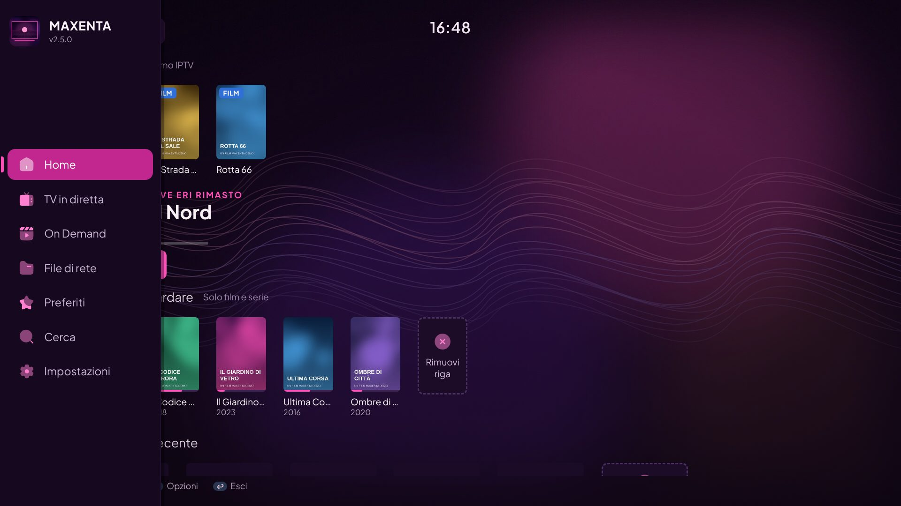 **Barra laterale** (Aspetto A): a sole icone, si apre con i nomi quando ci entri | 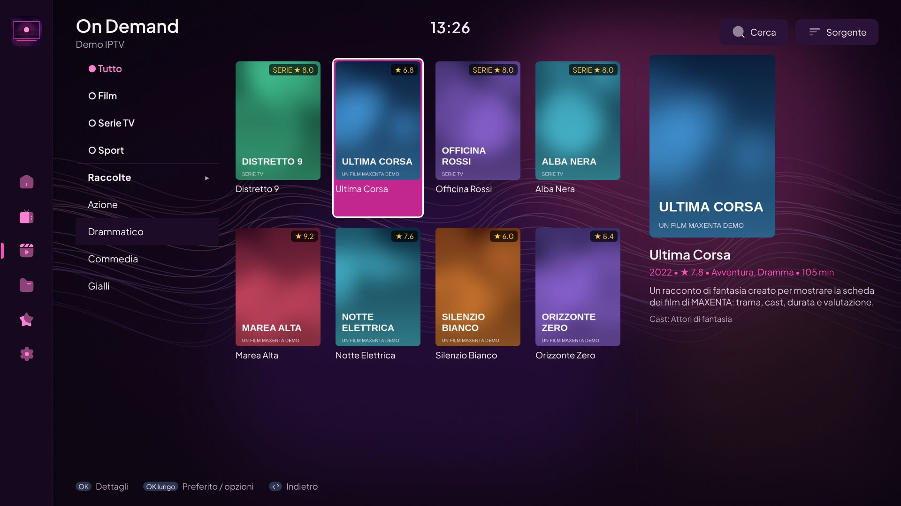 **On Demand**: filtri e raccolte a sinistra, film e serie insieme |
| 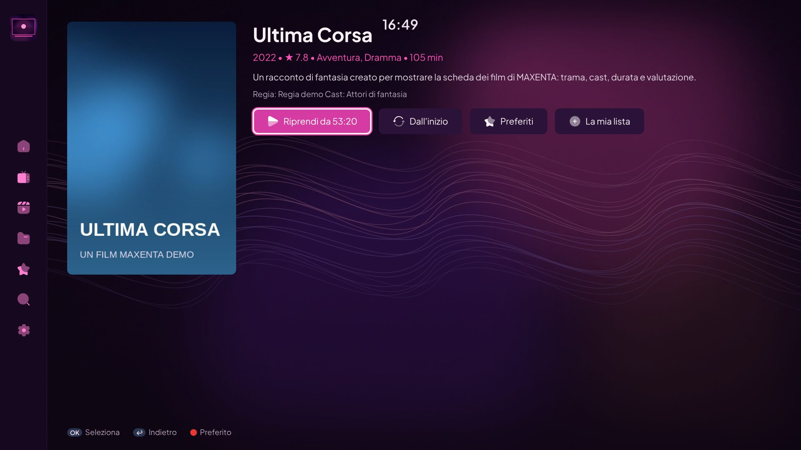 **Scheda film** con Riprendi, Preferiti e La mia lista | 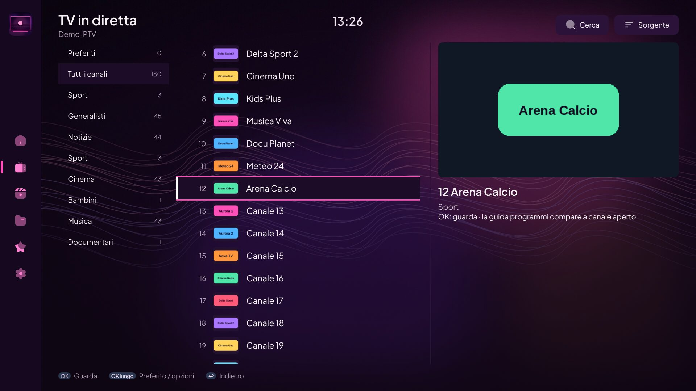 **TV in diretta** con categoria Sport automatica |
| 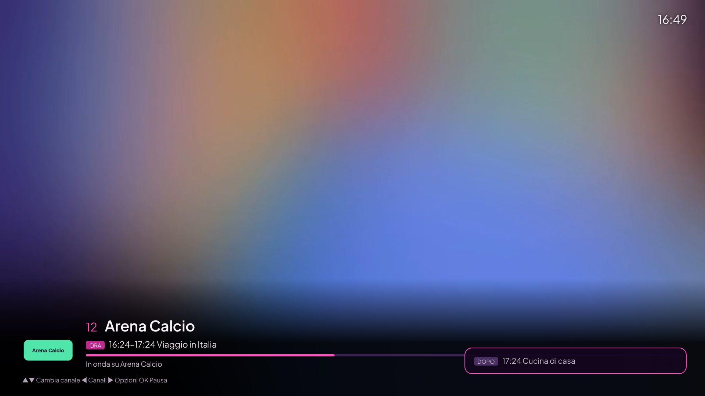 **Player** con guida programmi | 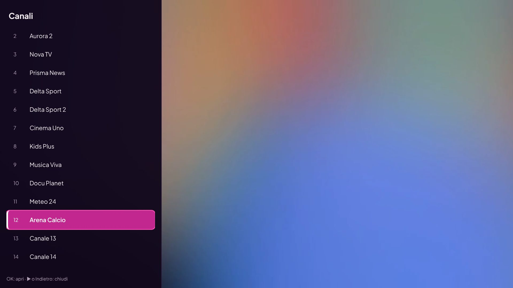 **Sinistra** nel player: elenco canali |
| 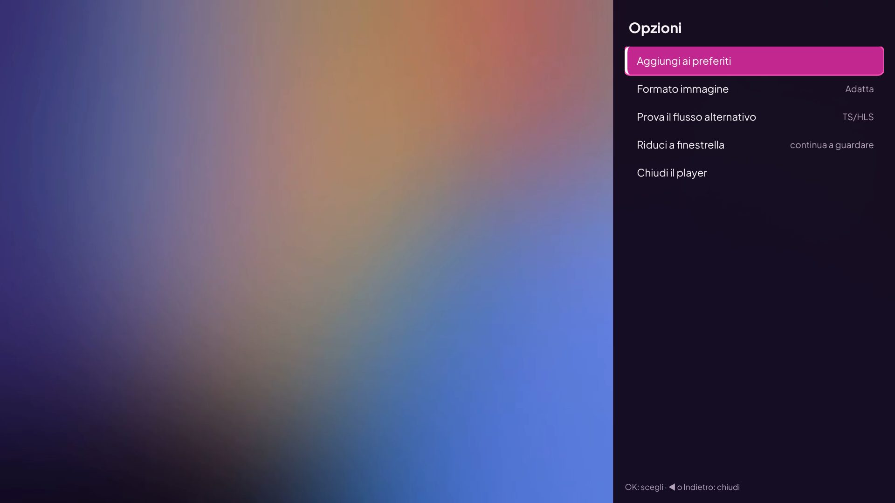 **Destra** nel player: opzioni | 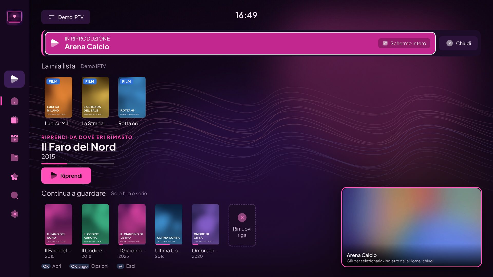 **Finestrella** e tessera *In riproduzione* |
| 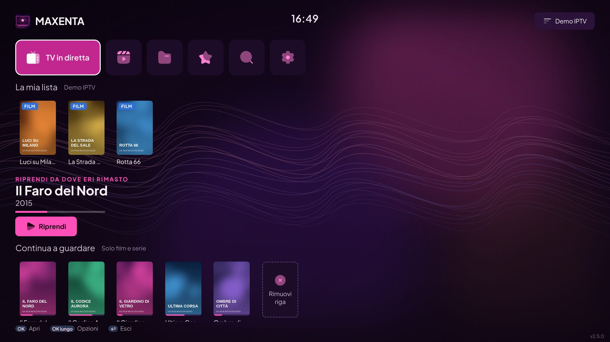 **Aspetto B**: pulsanti a icone, il selezionato mostra il nome | 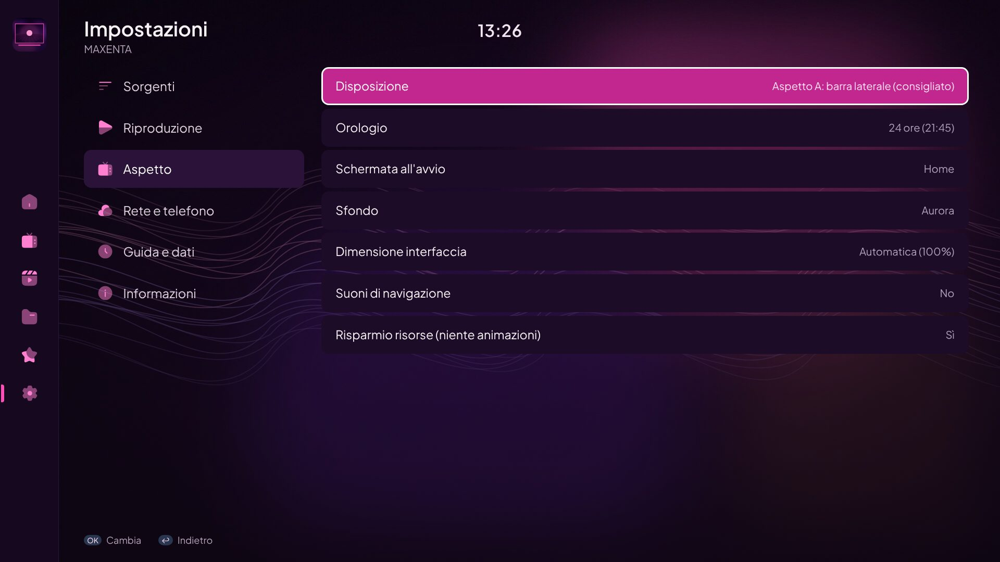 **Impostazioni** a categorie |
| 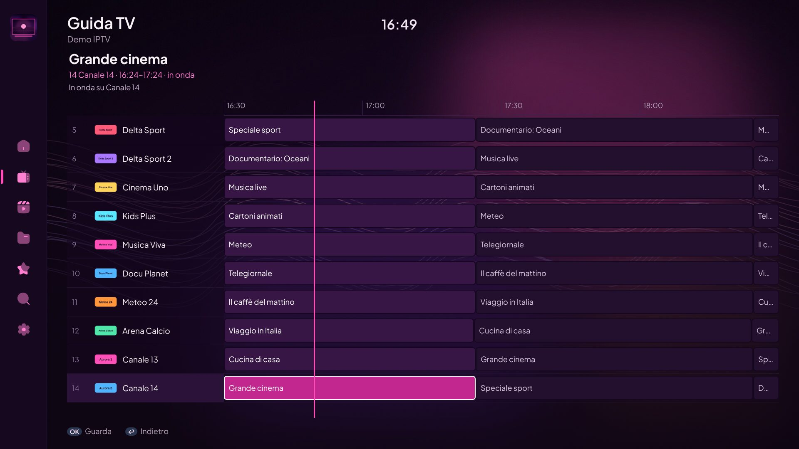 **Guida TV** a griglia | 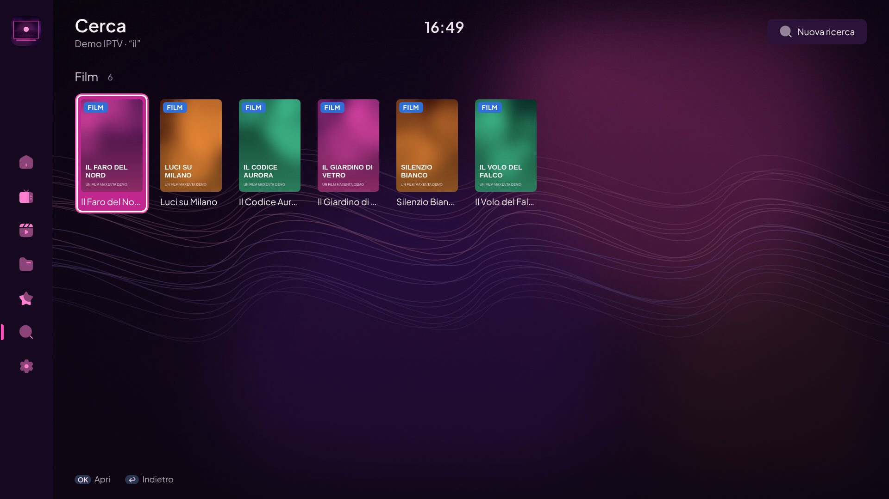 **Ricerca unica** su canali, film e serie |
| 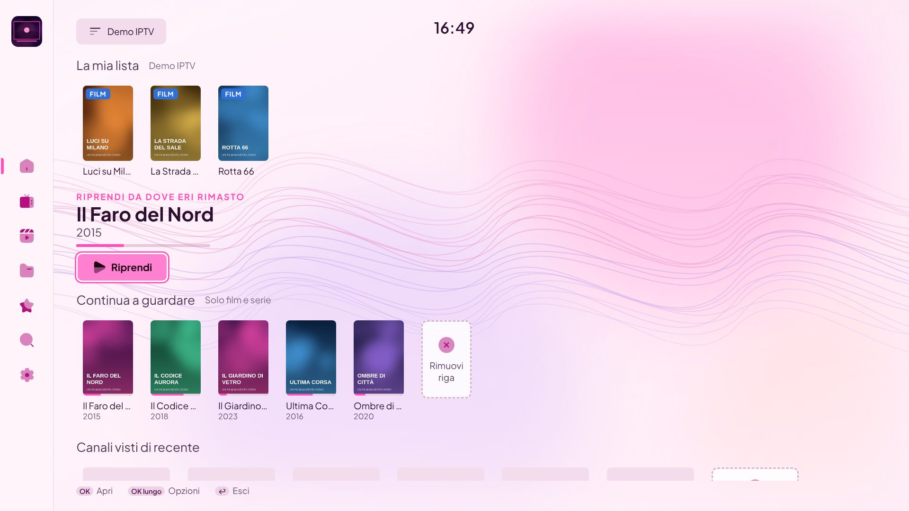 **Tema chiaro** con i suoi sfondi | |

---

## Piattaforme e installazione

Tutti i pacchetti si scaricano dalla pagina **[Releases](https://github.com/Signorken/tv-player/releases/latest)**.

| Piattaforma | File | Si aggiorna da solo? |
|---|---|---|
| **Android TV · Google TV** (Chromecast, Thomson, Xiaomi, TV Sony/TCL/Philips…) | `MAXENTA-x.y.z-android-tv.apk` | Sì |
| **Amazon Fire TV** (Fire OS) | lo stesso `.apk` | Sì |
| **Samsung** (Tizen 4.0+, TV dal 2018) | `MAXENTA-x.y.z-tizen-unsigned.wgt` (va firmato) | Sì |
| **LG** (webOS 4.0+, TV dal 2018) | `MAXENTA-x.y.z-webos.ipk` | Sì |
| **Hisense** (VIDAA) | `MAXENTA-x.y.z-vidaa.zip` | Sì (se ospitato) |
| **Windows 10/11** | `MAXENTA-x.y.z-win-x64.exe` (+ versione portable) | Sì (installer) |
| **macOS 11+** (Intel e Apple Silicon) | `MAXENTA-x.y.z-mac-universal.dmg` | No: si scarica il nuovo `.dmg` (app non firmata) |
| **Linux** | `.AppImage` · `.deb` · `.rpm` | Sì (AppImage) |

### Android TV / Google TV / Fire TV
1. Sul dispositivo attiva le **Opzioni sviluppatore** (Impostazioni › Sistema › Info › premi 7 volte su *Build del sistema operativo*) e consenti l'installazione di **app sconosciute** per l'app che userai.
2. Installa l'APK in uno di questi modi:
   - con l'app **Downloader**: inserisci il link dell'APK dalla pagina Releases;
   - da PC: `adb connect IP-DEL-DISPOSITIVO:5555` e poi `adb install -r MAXENTA-x.y.z-android-tv.apk`;
   - copiandolo su una chiavetta USB e aprendolo con un file manager.
3. MAXENTA compare tra le app del launcher.

> **Dalla 2.7 l'APK si aggiorna da dentro l'app**: quando esce una versione con codice nativo nuovo, MAXENTA lo propone, scarica l'APK da GitHub e apre l'installazione di Android (basta premere *Installa*; la prima volta va consentito a MAXENTA di installare app). L'APK 2.7 va installato a mano una volta sola.
>
> **Dalla 2.6 l'APK è firmato sempre con la stessa chiave**: le versioni successive si installano sopra senza disinstallare (e senza perdere sorgenti e preferiti). Il passaggio alla 2.6 richiede un'ultima disinstallazione.
>
> Con ExoPlayer l'app **adatta la frequenza dello schermo al video** (canali a 25/50 fotogrammi → 50 Hz), disattivabile in *Impostazioni › Riproduzione*.
>
> **Dalla 2.5 l'APK contiene il lettore ExoPlayer** (codice nativo): l'aggiornamento automatico dell'interfaccia non basta, va installato una volta l'APK 2.5 (sopra quello vecchio, i dati restano).
>
> **Dalla 2.4 il pacchetto si chiama `com.maxenta.app`** (prima `com.example.tvplayer`): per Android è un'app nuova. Disinstalla la vecchia versione e installa la nuova; sorgenti e preferiti vanno reinseriti una volta.
>
> Fire TV con **Vega OS** (Fire TV Stick 4K Select, Stick HD 2026) non esegue APK. I Fire TV più vecchi (Fire OS 5) non sono supportati.

### LG webOS
Serve la **modalità sviluppatore** di LG (gratuita):
1. Crea un account su [webostv.developer.lge.com](https://webostv.developer.lge.com).
2. Sulla TV installa da *LG Content Store* l'app **Developer Mode**, accedi, attiva **Dev Mode Status** (la TV si riavvia), poi attiva **Key Server** e annota IP e passphrase.
3. Sul PC usa **webOS Dev Manager** (programma gratuito con interfaccia grafica, progetto *dev-manager-desktop* su GitHub): aggiungi la TV con IP e passphrase e installa `MAXENTA-x.y.z-webos.ipk`. In alternativa da riga di comando: `ares-setup-device`, poi `ares-install MAXENTA-x.y.z-webos.ipk -d TV`.
4. La modalità sviluppatore **scade dopo 50 ore**: apri ogni tanto l'app *Developer Mode* e premi *Extend*. Se scade, LG toglie le app installate così e va reinstallato l'`.ipk`.

Senza modalità sviluppatore puoi usare il **browser della TV** con il companion (vedi sotto): `http://IP-DEL-PC:8787/app/`.

### Samsung Tizen
Il file `.wgt` va **firmato con un certificato Samsung** legato al tuo account e alla TV:
1. Installa **Tizen Studio** con le estensioni *Samsung Certificate Extension* e *TV Extensions*.
2. Sulla TV attiva la *Developer mode* (*App* › digita `12345` › ON, inserisci l'IP del PC, riavvia).
3. In Tizen Studio apri il **Certificate Manager**, crea un profilo **Samsung** di tipo **TV** inserendo il **DUID** della TV (lo legge il *Device Manager* collegandosi alla TV).
4. Firma e installa: `tizen package -t wgt -s PROFILO -- MAXENTA-x.y.z-tizen-unsigned.wgt`, poi `tizen install -n MAXENTA.wgt -t TV`.

La firma in automatico nella CI si attiva salvando i certificati come *secret* del repository (da configurare).

### Hisense VIDAA
Non esiste un'installazione libera: apri nel **browser della TV** l'indirizzo del companion (`http://IP:8787/app/`) e salvalo nei preferiti, oppure pubblica `MAXENTA-x.y.z-vidaa.zip` tramite il portale sviluppatori VIDAA.

### Windows, macOS, Linux
- **Windows**: esegui l'installer `.exe` (per utente, senza permessi di amministratore). Non è firmato: SmartScreen mostra *Windows ha protetto il PC* → *Ulteriori informazioni* › *Esegui comunque*.
- **macOS**: apri il `.dmg` e trascina MAXENTA in Applicazioni. La prima volta tasto destro › *Apri* (app non firmata), oppure `xattr -dr com.apple.quarantine /Applications/MAXENTA.app`.
- **Linux**: `chmod +x MAXENTA-*.AppImage` e doppio clic; oppure `sudo apt install ./MAXENTA-*.deb`.

---

## Aggiornamenti automatici

| Dove | Come funziona |
|---|---|
| **TV** (Android, Fire TV, Tizen, webOS, VIDAA) | Il pacchetto installato è un **guscio**: a ogni avvio legge la versione pubblicata sul ramo [`updates`](https://github.com/Signorken/tv-player/tree/updates) di questo repository e, se è più nuova, scarica il programma (~200 KB), lo conserva sulla TV e lo avvia. Senza rete usa l'ultima copia salvata; se una versione scaricata non parte viene scartata e si torna alla precedente. Reinstallare il pacchetto serve solo se cambiano icona, permessi o file grafici di base. *Impostazioni › Informazioni › Verifica aggiornamenti* controlla subito |
| **Windows, Linux AppImage** | Controllo all'avvio dalle GitHub Releases, download in background e *Riavvia ora* |
| **macOS, Linux .deb/.rpm** | L'app avvisa e scarica il nuovo pacchetto da installare a mano |

---

## Comandi

Il telecomando di riferimento è quello **moderno senza tasti numerici né colorati** (frecce, OK, Indietro, Home, Play/Pausa). Gli altri tasti, se ci sono, aggiungono scorciatoie.

### Navigazione
| Tasto | Azione |
|---|---|
| Frecce / OK / Indietro | sposta, apri, torna indietro |
| **OK tenuto premuto** | menu opzioni dell'elemento (preferiti, La mia lista, togli dalla riga…) |
| **Sinistra** dal primo elemento | apre la **barra laterale** (Aspetto A); Destra o Indietro la richiudono |
| **Indietro dalla Home** | chiude il video nella finestrella; poi chiede se uscire |
| **Indietro tenuto premuto** | chiude il player o la finestrella |

### Nel player
| Tasto | Diretta | Film ed episodi |
|---|---|---|
| **Su / Giù** | canale successivo / precedente | — |
| **Sinistra** | pannello **Canali** | pannello **Episodi**; con le informazioni visibili: −10 s |
| **Destra** | pannello **Opzioni** | pannello **Opzioni**; con le informazioni visibili: +10 s |
| **OK** | informazioni, poi pausa / riprendi | informazioni, poi pausa / riprendi |
| **OK tenuto premuto** | pannello Opzioni | pannello Opzioni |
| **Indietro** | finestrella (o chiude, a seconda delle impostazioni) | idem |
| **▶‖** | pausa / riprendi; con la finestrella: schermo intero | idem |

### Finestrella
- Si raggiunge dalla voce **In riproduzione** della barra laterale, dalla barra in cima alla Home (tornando alla Home il cursore è già lì), oppure andando Giù dal fondo della pagina.
- Selezionata mostra due pulsanti: **Schermo intero** e **Chiudi** (Sinistra/Destra per scegliere).
- *Impostazioni › Riproduzione › Finestrella*: sempre, solo canali TV, solo film e serie, mai.

### Tasti facoltativi
Numeri 0–9 (canale diretto) · CH± · 🔴 preferito · 🟢 cerca · 🟡 sorgente / rimuovi riga · 🔵 audio e sottotitoli · ⏪⏩ ±30 s.
Sul computer: frecce, Invio, Esc, F1–F4 = colori, PagSu/PagGiù = CH±, **Ctrl + / Ctrl − / Ctrl 0** = dimensione dell'interfaccia, F11 o *Massimizza* = schermo intero.

---

## Impostazioni principali

| Categoria | Voci |
|---|---|
| **Sorgenti** | aggiungi, modifica, aggiorna elenco, elimina, sorgente attiva |
| **Riproduzione** | **lettore video** (nativo ExoPlayer/AVPlay o web), **frequenza dello schermo 50 Hz** (Android), **episodio successivo automatico**, formato dirette Xtream (HLS/TS), lingua audio preferita, **finestrella**, anteprima video scorrendo i canali, buffer, convertitore (computer) |
| **Aspetto** | **lingua** (automatica, italiano, inglese), **tema** (scuro/chiaro), **disposizione A/B**, orologio 12/24 h, **schermata all'avvio** (Home, TV, On Demand, Sport, Preferiti, ultimo canale), sfondo, **dimensione interfaccia** (automatica 100%, 70–150%), **suoni di navigazione**, **prestazioni** (automatiche / massima qualità / leggere), **indicatore prestazioni** |
| **Rete e telefono** | telefono come tastiera/telecomando (QR), server companion, identità del lettore (computer) |
| **Guida e dati** | finestra della guida programmi (6–48 h), svuota cache e guida |
| **Informazioni** | versione, verifica aggiornamenti, piattaforma e comandi, crediti |

In ogni categoria le voci sono in ordine alfabetico.

---

## Telefono come tastiera e telecomando (companion)

Le app per TV non possono ricevere connessioni dirette, quindi il telefono passa da un piccolo server **companion** (Node.js, nessuna dipendenza) da avviare su un PC, NAS o Raspberry Pi della stessa rete:

```bash
node companion/server.js          # porta 8787
docker compose up -d --build      # oppure con Docker
```

Fa tre cose:
- **relay** telefono ⇄ TV: inquadri il QR in *Impostazioni › Rete e telefono* e scrivi dal telefono, usi le frecce, invii playlist, account Xtream e link;
- **proxy** per i server che bloccano le richieste dal browser (aggiunge CORS, gestisce Range, `.gz`, manifest HLS);
- **ospita l'app** su `http://IP:8787/app/`, utile per VIDAA e per provarla nel browser di qualsiasi TV o PC.

Accetta solo dispositivi della rete locale (`ALLOW_PUBLIC=1` per cambiare, `TOKEN=…` per proteggere il proxy).

---

## App per computer

La stessa app in una finestra **Electron**, con adattamenti per mouse e tastiera:
- **Ctrl+V** ovunque aggiunge ciò che hai copiato: link M3U, link `get.php?username=…` di un provider Xtream (riconosce da solo server, utente e password), WebDAV, testo di una playlist;
- trascina un file `.m3u` nella finestra, oppure **Ctrl+O**; l'app si registra come lettore di `.m3u/.m3u8`;
- **Cerca NAS in rete** (DLNA/SSDP e mDNS), **NAS Windows** (`\\NAS\cartella` o `smb://NAS/cartella`, con elenco delle condivisioni su Windows), cartelle del computer; le sottocartelle si salvano come accesso rapido;
- clic, tasto destro (opzioni), rotella, barra di avanzamento cliccabile, Spazio, F, M;
- **convertitore ffmpeg** integrato per i file che il motore di Chromium non legge (HEVC, AC3/DTS, alcuni MKV) o che non si possono scorrere: automatico, oppure da *Opzioni › Usa il convertitore video*;
- se il provider blocca i browser, *Impostazioni › Identità del lettore* (VLC, Kodi, okhttp).

---

## Sviluppo

```bash
npm install
node companion/server.js        # app su http://localhost:8787/app/
npm run build                   # src/ -> www/app.js
npm run desktop                 # app per computer
npm test                        # prove automatiche (servono test/mock.js e il companion avviati)
node scripts/screenshots.js     # rigenera gli screenshot del README (serve anche test/demo.js)
```

| Cartella | Contenuto |
|---|---|
| `src/core` | tasti, navigazione spaziale, archivio, rete, parser M3U/XMLTV, guida, router |
| `src/sources` | M3U, Xtream, WebDAV/HTTP, cartelle locali |
| `src/ui` | lista virtualizzata, barra laterale, tastiera, finestre, icone, suoni, motore video |
| `src/screens` | home, diretta, on demand, scheda, file, preferiti, impostazioni, player |
| `desktop/` | Electron: finestra, aggiornamenti, convertitore, DLNA, SMB |
| `packaging/` | Android (Capacitor + `MainActivity` per Indietro lungo), Tizen, webOS, VIDAA, **guscio auto-aggiornante** (`shell/loader.js`) |
| `companion/` | relay, proxy, pagina del telefono, Dockerfile |
| `test/` | server finto (`mock.js`), server dimostrativo (`demo.js`), prove e2e |
| `docs/` | screenshot e dati dimostrativi |

**Rilasciare una versione**: *Actions › Build › Run workflow* con il numero di versione. La CI compila Windows, macOS, Linux, APK, IPK, WGT e VIDAA, pubblica la Release e aggiorna il ramo `updates` letto dalle TV.

Compatibilità: il bundle è compilato per **Chromium 53+** (webOS 4, Tizen 4): niente CSS grid, `gap` nei flex o API recenti.

---

## Cosa è verificato

- **Prove automatiche** (`npm test`, oltre 120 controlli) in Chrome guidando l'app **solo con i tasti**, contro server finti: sorgenti M3U e Xtream (3.000 canali), guida, film, serie, ricerca, preferiti, La mia lista, ripresa, finestrella e sua chiusura, barra laterale, Aspetto B, tastiera, OK e Indietro lunghi, pannelli del player, NAS WebDAV, telefono come telecomando, dimensione automatica, lettore nativo (con un lettore finto), ordinamento On Demand, La mia lista in Home, lingua inglese.
- **App per computer** provata con Electron reale (`test/desktop*.js`): incolla link, cartelle, NAS, convertitore, tracce audio multiple.
- **Guscio delle TV** (`test/shell-test.js`): aggiornamento, funzionamento senza rete, scarto di una versione difettosa.
- **Provato dall'autore** su Samsung QN90C (Tizen), Thomson Streaming Stick 140 (Google TV), portatile Linux e Mac.
- **Non verificato**: Hisense VIDAA reale, Fire TV, installer Windows su macchina reale.

---

## Prestazioni

Dispositivo di riferimento **minimo**: **Thomson Streaming Stick 140** (Amlogic S905Y4, 4× Cortex-A35 a 2 GHz, GPU Mali-G31 MP2, 2 GB di RAM).

- **Video nativo**: su Android/Google TV (ExoPlayer) e Samsung (AVPlay) il video non passa dalla pagina web ma va direttamente al decoder e allo schermo; sulla Thomson era la causa principale dei fotogrammi persi in 1080p. L'indicatore prestazioni mostra quale lettore è in uso e i fotogrammi persi.
- **Profilo automatico**: all'avvio un breve test misura la CPU; sui televisori e sulle chiavette con ≤2 GB di RAM o CPU lenta si usa il profilo **leggero** (nessuna animazione, niente anteprime video in lista). Si può forzare in *Impostazioni › Aspetto › Prestazioni*.
- **Animazioni solo "economiche"**: si animano opacità e spostamento di blocchi interi, mai colori, ingrandimenti o larghezze (che costringono la GPU a ridisegnare a ogni fotogramma).
- **Liste virtualizzate** con scorrimento ai bordi e riuso delle righe: scorrendo si riempie solo la riga nuova e si ridisegnano poche righe.
- **Tasto tenuto premuto**: al massimo un passo per fotogramma, così la lista non accumula ritardo.
- **Guida programmi** solo a canale aperto; **locandine TMDB** richieste alla misura necessaria (w342) invece che in originale; librerie video e QR caricate solo quando servono; sfondo e righe senza livelli grafici superflui.
- **Indicatore prestazioni** (*Impostazioni › Aspetto*): fotogrammi al secondo, ritardo dei tasti, profilo, RAM, core e risultato del test.
- Banco di prova: `node test/perf.js 12` (CPU rallentata 12 volte, circa la Thomson) misura ogni schermata tasto per tasto.

## Limiti noti

- **Codec**: sulle TV conta il decoder del televisore (HEVC, AC3/E-AC3, MKV dipendono dal modello). Il convertitore esiste solo sull'app per computer.
- **SMB e DLNA** sulle TV non sono raggiungibili da un'app web: usa WebDAV/HTTP sul NAS, oppure l'app per computer.
- Niente DRM, registrazioni, catch-up. Interfaccia in italiano e inglese.
- macOS e Samsung richiedono certificati a pagamento o legati all'account per installazione e aggiornamento senza passaggi manuali.

---

## Crediti e licenze

- Icone **[Solar](https://github.com/480-Design/Solar-Icon-Set)** di 480 Design — CC BY 4.0
- Font **Plus Jakarta Sans** — SIL Open Font License
- **hls.js** e **mpegts.js** — Apache 2.0
- **ffmpeg** (app per computer, tramite ffmpeg-static) — GPL: se ridistribuisci l'app rispetta la licenza o sostituiscilo con una build LGPL
- Sfondi astratti e dati dimostrativi creati per il progetto
